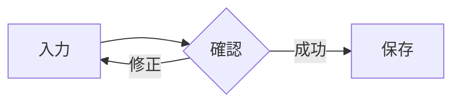
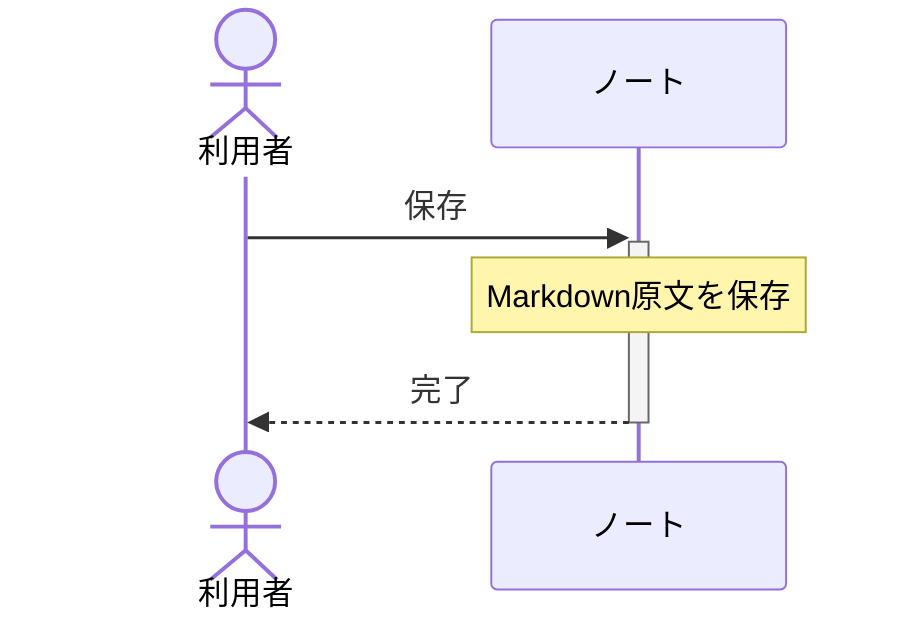

# Markdownの書き方

NeNe Folioの閲覧表示で使う記法をまとめています。編集モードではMarkdownの原文を編集します。
表示のための見出し・表・チェックの印を、保存ファイルへ書き足すことはありません。
この文書は現在の開発版の対応範囲です。公開済みv0.3.0 betaの範囲は[公開時の品質記録](quality/2026-10-26-markdown-syntax.md)を参照してください。
完全なCommonMark/GFM互換を意味するものではありません。

## 見出しと本文

`#`から`######`までの見出しを使えます。`####`以降は本文と同じ大きさ・通常の太さで、色と余白で区別します。
文字の次の行へ`===`または`---`を置く書き方は、それぞれh1/h2になります。

```markdown
# 大きな見出し
## 節
### 小節
#### 本文サイズの見出し

別の見出しの書き方
==================
```

空行で段落を分けます。段落内の通常の改行は空白としてつながります。
明示的に改行する場合は、行末へ空白を2個置くか、backslashを1個置きます。

```markdown
1行目\
2行目
```

## 行内の装飾

| 書き方 | 意味 |
| --- | --- |
| `**太字**`、`__太字__` | 太字 |
| `*斜体*`、`_斜体_` | 斜体 |
| `~~取り消した内容~~` | 取り消し線 |
| `` `code` `` | 等幅のコード |
| `[表示文字](https://example.com/)` | リンク文字の下線と色 |
| `<https://example.com/>`、`<name@example.com>` | URL・メールアドレスの下線と色 |
| `\*`、`\[`、`\|` | 記号をそのまま表示 |

現在のソースでは、閲覧中のHTTP/HTTPSリンクを左クリック、またはリンク内でCtrl+Enterすると、既定ブラウザーへ開きます（#482）。
文字をドラッグ選択した場合、修飾キー付きクリック、編集中・IME変換中には開きません。
メール、file、相対リンク、裸のURLは起動しません。公開済み0.3.0 betaのリンクは装飾のみです。
リンク先は最大8192 UTF-8 bytesで、空のhost部、制御/空白文字、引用符、backslash、userinfoを含むものは起動対象にしません。
表示名付きリンクのURL内のescape・対応文字参照は展開しますが、`<URL>`内は原文のまま扱います。
閉じていない装飾記号は文字として残ります。コードの内側では強調やリンクを解釈しません。
コード内にbacktickを入れる場合は、囲むbacktickを2個以上にし、始めと終わりの個数を合わせます。

URL・メールアドレスの自動リンクは`<`と`>`で囲みます。空白を含むものや閉じていないもの、
囲んでいないURLは自動リンクになりません。コード内・画像の原文内では解釈しません。

本文・見出し・表セルでは、`&amp;` → `&`、`&lt;` → `<`、`&gt;` → `>`、`&quot;` → `"`、
`&apos;` → `'`、`&nbsp;` → 改行しない空白を使えます。数値指定の`&#65;`、`&#x41;`はいずれも`A`です。
末尾の`;`は必須です。10進は1〜7桁、16進は1〜6桁で、NULや不正なUnicode値は`�`になります。
改行文字を数値で指定した場合は段落内の空白として表示します。
この6種以外のnamed参照は原文表示です。コード、画像の説明文字、自動リンクの内側では展開しません。
展開された`*`などを装飾記号として再解釈することはありません。

## リスト・チェックリスト・引用

子の項目や継続本文は、親の項目の本文に合わせて字下げします。
番号付きリストは`1.`と`1)`を使え、先頭の番号から連番で表示します。子リストは別の番号を持ち、親へ戻ると続きを表示します。
チェックの印は閲覧表示用で、クリックによる切替はありません。
変更するときは編集モードで`[ ]`と`[x]`を書き換えます。`[X]`も完了として扱います。
印の直後は半角空白またはタブで区切ります。
引用の中のリストと、引用・リストそれぞれの入れ子に対応します。
リストの中へ引用を置き、空行の後で同じ親リストの継続本文へ戻れます。親の番号も続きます。
引用の段落が続いている間は、次の本文行の`>`を省略できます。親本文へ戻すときは空行を挟み、親の本文に合わせて字下げします。
空の項目でも印を表示します。項目がコードブロックや表から始まる場合や、複数のリストが本文なしで続く場合は、外側の印を短い専用行へ表示します。

```markdown
- 親の項目
  - 子の項目
  - [ ] 未完了
  - [x] 完了

1. 最初の項目
   1. 子の項目
2. 次の項目

> 引用
> > 引用の中の引用
> - 引用の中の項目

7. 親の項目
   > 引用の本文

   親へ戻った本文
1. 8として表示する次の項目
```

## コードブロック

backtickまたはtildeを3個以上並べて囲みます。開いた記号と同じ種類を、同じ個数以上並べた行で閉じます。
短い記号列や別の種類の記号列はコード内に残ります。空行や字下げを保持します。
開始行の記号の直後へ言語名を書くと、閲覧時にキーワード・文字列・コメント・数値を色分けします。
色分けの判定は英字の大小を区別せず、先頭の空白区切り語を使います。閲覧時はその語を
コード面の上部にも小さく表示します。`PyThOn`や`C++`など指定した表記を保ち、後続の説明は表示しません。
未対応の言語名や`text`も表示し、指定がない場合はラベルを出しません。指定付きの空ブロックはラベルだけを表示します。
ラベルは検索・選択でき、長い名前は幅に合わせて折り返します。ラベルも選択するとコピーに含まれます。
コード本文だけを選択したコピー、ノートの保存・書き出し・編集は元の内容を保ちます。

| 言語 | 指定できる名前 |
| --- | --- |
| C / C++ | `c` / `cpp`, `c++`, `cc`, `cxx` |
| JavaScript / TypeScript | `javascript`, `js` / `typescript`, `ts` |
| Python | `python`, `py`, `python3` |
| JSON | `json` |
| Shell / Bash | `sh`, `shell`, `bash`, `zsh` |
| PowerShell | `powershell`, `ps1`, `pwsh` |
| SQL | `sql` |

未指定・`text`・`plaintext`・`txt`・未知の言語名は単色で表示します。
基本的な字句の色分けであり、補間式の内側、JavaScriptの正規表現、C++のraw文字列、Shellのhere-document、
SQL方言固有の引用などは厳密に区別しません。原文は保持します。高コントラストではOSの文字色に揃えます。

````markdown
```c
int value = 1;

    call(value);
```

~~~text
こちらもコードブロック
~~~
````

## 表

見出し行の次に、同じ列数の区切り行を置きます。区切り行のcolonで左・中央・右寄せを指定できます。
行の先頭と末尾のpipeは省略できます。表の終了には空行を置くと明確です。
1列の表でも外側pipeは省略できます。区切り行を`---`だけにするとsetext見出しになるため、`|---|`や`:---:`を使います。
ATX見出し、水平区切り、コードブロックの開始行を表の見出し行として扱うことはありません。

```markdown
| 名前 | 状態 | 数量 |
| :--- | :---: | ---: |
| **Alpha** | 完了 | 12 |
| Beta | `確認中` | 3 |
```

セルにpipeを表示するときは`\|`と書きます。コード内のpipeも同じです。
見出しと区切り行の列数が合わない場合は表として扱いません。
本文行の足りないセルは空になり、見出しより多いセルはGFMの規則に従い閲覧表へ表示されません。原文は保持します。
表の中に、複数段落や別の表などのblockを入れることはできません。

表は最大63列、親本文の字下げは32767twipまで対応します。どちらかを超える入力は表へ変換せず、元の記法を表示します。
この原文表示ではリスト・引用の記号や入力した番号もそのまま表示し、印を重ねて追加しません。後続の通常項目ではリストの連番表示に戻ります。
引用やリストの中の表は、左端を親本文の字下げへ揃え、残りの本文幅を列へ均等に配ります。
列幅は本文の幅と倍率に合わせて調整し、長いセルは折り返します。列の多い表は、窓を広げるか表示倍率を下げると読みやすくなります。
字下げが本文幅以上のときは列幅が0になり、表の構造を保ったまま、幅や倍率の変更で再配置します。
極狭幅の表の文字が読める保証はありません。原文は編集モードで確認できます。

## 水平区切り

同じ`-`、`*`、`_`を3個以上並べます。記号の間に空白を入れても使えます。
`----`、`***`、`___`はいずれも水平区切りになります。
本文の直後の`---`はsetext見出しになるので、水平区切りにする場合は前に空行を置きます。
線の上下には12ptずつ空白を置きます。前後の段落や見出しが持つ通常の余白も維持します。

```markdown
前の段落

----

次の段落
```

## 画像

1.2.0以降は、PNG/JPEGをローカルパスまたはHTTPS URLで指定できます（#520）。
相対パスの基準は、そのMarkdownを保存しているカテゴリのフォルダーです。

```markdown

```

ローカル画像ではURL部分を`images/photo.png`のようなパスへ置き換えます。
空白を含むパスは`<images/my photo.jpg>`のように山括弧で囲みます。
山括弧内のパスや引用符で囲んだタイトルの丸括弧は、画像記法の終端と区別します。

本文を先に表示し、画像は代替アイコンと説明を置いて画面の近くから読み込みます。
縮小が必要な間はステータス行に「画像を加工しています」と動くメーターを表示します。
メーターは処理中であることを示すもので、完了率ではありません。失敗時は説明と案内を残し、
編集から閲覧へ戻ると再試行します。画像を待っている間も本文を操作できます。

表示用の画像は縦横比を保って長辺2048画素以下へ縮小し、本文幅や表セル幅に収めます。拡大はしません。
ミニマップには画像の位置と表示サイズに応じたブロックを表示します。画像が大きい箇所でも、ホイール一回の移動量は本文の文字サイズに合わせます。
1枚の入力は16MiB・元画像64M画素まで、1文書で表示する画像と図は合わせて先頭256件までです。
元画像や入力したMarkdownを変更せず、画像を自動移動・取り込みすることもありません。
`images/`以外のローカル参照には、持ち出しやすい配置をステータス行で控えめに案内します。
HTTPS画像は外部のURLへアクセスして表示し、通常のデータフォルダーへ保存しません。

ローカル参照はドライブ上の通常ファイルが対象です。UNC・ネットワークドライブ・デバイスパス、
symlink/junction・クラウドの未取得ファイル等のreparse pointを通る参照には対応しません。
SVG・GIF・WebP・動画・参照形式の画像は対象外です。ファイルを外部で変更した場合は閲覧へ入り直します。
カテゴリ間でノートを移動しても画像やパスは移さないため、相対参照は新しいカテゴリを基準に読み直します。

括弧が閉じた画像記法を対象にします。説明の内側の強調記号・backtick等は文字として残ります。
画像全体を囲む強調やリンクは適用されます。画像記法全体をbacktickで囲む場合はコードです。
通常本文で感嘆符をbackslashでescapeした場合は画像とせず、後続をリンクとして扱います。
書き出し時の画像の扱いは[取り込みと書き出し](TRANSFER.md)を参照してください。

## Mermaidの図

1.3.0では、`mermaid`と小文字で指定したコードブロックを閲覧時に図として表示します（#539）。
本文を先に表示し、画面の近くにある図から読み取り・配置・描画を進めます。
画像と同じ通知行の動くメーターを使い、処理中も本文を操作できます。メーターは完了率を表しません。
配色は現在のテーマ、文字は本文と同じ言語の書体を使います。幅と倍率の変更は画像と同じ再配置へ渡します。
編集・保存・単票/ZIP書き出しにはMermaidの原文を保ちます。生成した図の画像をノートへ保存しません。

````markdown



````

今回の対応範囲はフローチャートとシーケンス図です。Mermaid.jsと同じ位置や曲線になる保証はありません。

| 種類 | 対応する記法 |
| --- | --- |
| フローチャート | `flowchart` / `graph`、`TB` / `TD` / `BT` / `LR` / `RL`、ノードIDとラベル、辺の連鎖、戻り辺・自己辺 |
| ノードの形 | 四角、角丸、stadium、subroutine、cylinder、circle、double circle、diamond、hexagon、左右parallelogram、上下trapezoid、asymmetric。従来の括弧記法を使用 |
| 辺 | 実線・破線・太線・非表示、矢印・丸・×、pipeで囲むラベルと辺の途中のラベル |
| サブグラフ | `subgraph ID [見出し]`〜`end`、入れ子。図全体と異なる`direction`、サブグラフそのものを端点にする辺は未対応 |
| シーケンス図 | `sequenceDiagram`、`participant` / `actor`と`as`、暗黙の参加者、メッセージ・自己メッセージ・双方向矢印 |
| 注釈・処理区間 | `Note over` / `left of` / `right of`、`activate` / `deactivate`、メッセージの`+` / `-`、`autonumber`（開始値・増分・`off`）、`title` |
| 分岐・反復の枠 | `loop` / `alt` / `opt` / `par` / `critical` / `break`〜`end`。対応する`else` / `and` / `option` |

日本語ラベル、引用符付きラベル、`<br>` / `<br/>` / `<br />` / `\n`での改行、基本の文字参照を使えます。
`%%`のコメントは図へ表示しません。未対応の種類・構文、壊れた構文、大きすぎる図は通知行へ案内を出します。
原文は編集画面で確認できます。`classDef` / `style` / `click`、設定directive、HTML装飾、Markdownラベル、
`&`でノードを束ねる省略記法、`@{...}`の新しい形指定、`box` / `rect` / `create` / `destroy`等は未対応です。
JavaScript・callbackを実行せず、図から外部の画像やURLを取得しません。

1図の原文は256KiB、ラベルは2048 UTF-8 bytes、ノード/参加者は256、辺は1024、
sequenceイベントは2048、サブグラフは64、入れ子は16段までです。1ノートの図原文の収集は合計4MiBまでです。
配置は各辺32768単位、表示bitmapは各辺8192画素・合計4M画素までとし、超える場合は図の分割を案内します。
幅に合わせた縮小で細部が読みにくくなる場合も、図を分けてください。

## 対応範囲

CommonMark/GFMの全構文への完全互換は保証しません。HTML描画、数式、脚注、独自wiki記法、
参照形式のリンク、上記6種以外のHTML named参照は未対応です。
未対応の記法は原文を編集・保存できます。表示上の制限や構文の取り違えがあれば、そのMarkdownを添えて報告してください。

リンクの表示文字内では、その内側で閉じる画像記法を対象にします。閉じていない場合や外側リンクの括弧を跨ぐ場合は、通常の行内記法として扱います。
画像・リンクのパスやタイトル内のbacktickは、後続本文のコード記法と組み合わせません。
左から成立した画像パス内の角括弧は、その外側のリンクを閉じる記号として使いません。
交差した記法で外側リンクが成立しない場合は、未閉じの文字と画像として表示します。
画像記法全体をbacktickで囲む場合はコードの規則を適用します。画像記法内の改行は空白としてつなぎ、表セルの `\|` はpipeとして表示します。

設計と検証の根拠: [ADR0070](adr/0070-markdown-syntax-and-native-tables.md)、
[ADR0071](adr/0071-ordered-markdown-containers.md)、[ADR0072](adr/0072-native-table-container-indent.md)、
[ADR0085](adr/0085-lazy-markdown-images.md)、[ADR0086](adr/0086-fenced-code-syntax.md)、
[ADR0089](adr/0089-native-lazy-mermaid.md)。

今回の軽い拡張は[ADR0078](adr/0078-lightweight-markdown-inline-rendering.md)、
未対応項目と公開後の候補は[Markdown対応の整理](quality/2026-10-31-markdown-scope.md)を参照してください。
