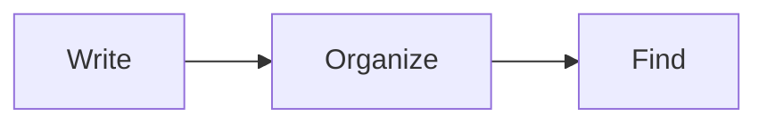

# 英語UIの公開版画像（#791）

## 目的と範囲

hideの判断で、dev.toの英語紹介記事に使う画像を英語UI・英語ノートへ差し替えるための2枚を追加した。
記事の差し替えは統合側の担当で、この作業ではdev.toを操作していない。
既存のdocs/images/1.3.2-main.png・1.3.2-themes.pngは外部記事が参照するため、削除も上書きもしていない。
READMEは英語文書なので、掲載画像と説明文を英語UIの2枚へ切り替えた。日本語UIの画像と
[その由来](2026-11-07-readme-current.md)は保持する。

## 採取元と合成データ

手順は[11月7日のREADME画像](2026-11-07-readme-current.md)と同じ経路。
公開ZIP D:/NeNeFolio/releases/1.3.2/github/NeNeFolio-1.3.2-win-x64.zipの
SHA256 e3922f11b227d089528f7880f27df4789b848a1b289871311faa36f48da36a34と全11payloadを照合し、
D:/NeNeFolio/outputs/791-en-screenshots/capture/へ展開した。
exe SHA256 092810e436e7857013e5658bd1f41a36b133edea67519bbb723ccd489b503793、配布source ba1e697deccb71e2f248f4759349d51ddec99e29。

合成データは3カテゴリ7ノート、すべて英語。settings.jsonは版3・行番号あり・theme light・language en。

| カテゴリ（色） | ノート |
| --- | --- |
| Getting Started（#7596B4） | Welcome、Handy Keys、Moving Your Data |
| Ideas（#B08AA2） | Weekend Plans、Books to Read |
| Work Notes（#83A991） | Daily Log、Release Checklist |

画面に写るWelcomeは、見出し「Write it down. Find it later.」、段落1つ、
「Organize your notes」の箇条書き3項目、「Turn ideas into diagrams」と次のMermaidからなる。

Welcome.mdのSHA256は63581435371d5d6d07a44bf917ca974dc847a1334a7b2de4bf190a2228a64552。
全12ファイルの本文とhashは原本のprepare.py・preparation.jsonにある。
採取後もノート7件・index 3件・categories.jsonのhashは不変。settings.jsonは製品が版5・theme nordへ書き直した。

## 採取手順

独立desktop上でexeをPID指定で起動し、主窓を1200×800へ揃えた。
入力は既存tools/post-keys.ps1のPID指定PostMessage、採取はtools/capture-window.ps1のDPI対応PrintWindow、
実行記録はtools/record-run.pyを使った。入力の順序は次のとおり。

1. `:set theme=light`、Enter
2. `ggl`、Enterで先頭のWelcomeを閲覧で開き、1枚目を採取
3. Esc、`:set theme=nord`、Enter
4. Ctrl+P、`Settings`、Enter、Enterでテーマ選択を開き、2枚目を採取
5. Esc、Esc、`:q`、Enterで通常終了

採取は3回行った。capture-01とcapture-02は同じ手順で、2枚とも全bytes/hashが一致した。
この2回は見出し先頭と検索欄に入力位置の縦線が写っていたため、採取前の待ちを300msから830msへ延ばしたcapture-03を採用した。
待ち時間以外の入力・データ・exeは同じ。capture-02以降は、capture-01が書き直したsettings.jsonから始まっている。

| 実行 | 製品PID / worker PID | 終了値 | 1枚目 SHA256の先頭 | 2枚目 SHA256の先頭 |
| --- | --- | --- | --- | --- |
| capture-01 | 17108 / 35108 | 0 / 0 | 34851bac | 6ce17ee2 |
| capture-02 | 42124 / 15660 | 0 / 0 | 34851bac | 6ce17ee2 |
| capture-03（採用） | 42636 / 6916 | 0 / 0 | 9b693f4c | 25a0ded4 |

3回とも前面window handle 446762454は前後不変、SwitchDesktopなし。
通常app・実ノート・clipboardは操作していない。通常exeは未起動のまま、
SHA256 ab97b69dcab303d8a75c09ed879237c9477939a64c1ddb6d8faabc02180018f1と更新日時が不変。

## 画像

| ファイル | 寸法 | bytes | SHA256 |
| --- | --- | --- | --- |
| docs/images/1.3.2-main-en.png | 1200×800 | 55741 | 9b693f4c22551e8646f377c1f7a234b8553c735f950714cc229aacf68744d1b2 |
| docs/images/1.3.2-themes-en.png | 1200×800 | 46188 | 25a0ded4c0b66e0c141173f131d75c697c6c10f5e79cd518b3d023002bc53bda |

画像の編集・合成はしていない。原本en3-main.png・en3-themes.pngとdocs/imagesの全bytes/hashが一致する。
2枚を目視し、1枚目で英語のUI・カテゴリ・ノート名・本文・Mermaidの3節点・status bar、
2枚目でNordの選択・テーマ一覧・「128 / 128 themes」を確認した。

日本語版との違いが一つある。テーマ一覧は英語UIで9行、日本語版の画像では10行が見える。
3回とも同じ9行で、選択中のnordが最下行に来る構図は同じ。行数が違う原因は調べていない。

既存の1.3.2-main.png（98e46596…）と1.3.2-themes.png（44d4a383…）のhashは不変。

## 検証・限界

変更は画像2枚・本記録・README・現在欄・11月10日日報。製品C・API・保存schema・版・ゲート・配布物に変更なし。
文書差分・相対参照・画像hash/寸法・実行結果・通常exe不変・conformanceを対象確認し、最終head必須CIを統合条件とする。
成功済みの機能試験は反復していない。
PrintWindowによる採取であり、DWM上の実画面や物理IMEの受理ではない。Store署名版の画面でもない。
FR-014、QLT-008/012/013、CNF-006、GIT-001〜004、ADR0043/0045。追加waiver none、既存WVR-0001継続。
原本はD:/NeNeFolio/agents/791-en-screenshots/（preparation.json、en3-ui-result.json、en3-desktop.json、runs/）。
